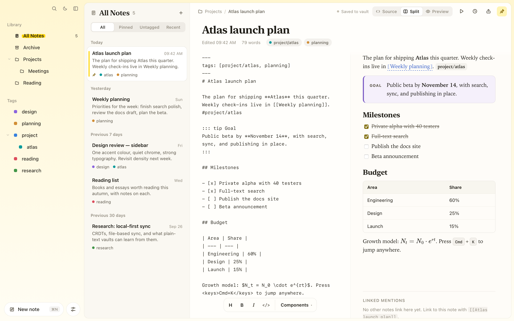
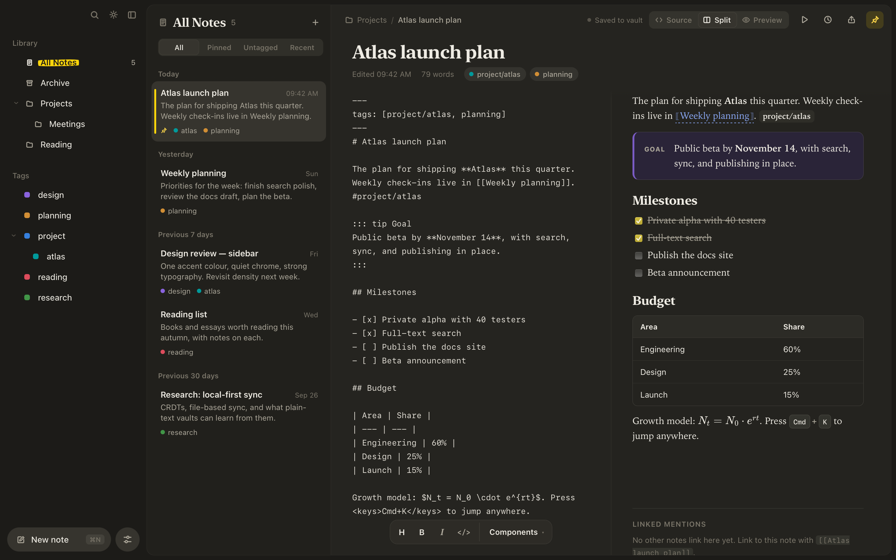

# Tagdown Editor

**A fast, local-first desktop editor for Tagdown notes — Markdown plus rich semantic blocks, tags, links, live queries, math, and diagrams.**

Tagdown Editor is a macOS-focused Tauri app for writing structured notes without giving up plain-text ownership. Notes are ordinary Markdown files on disk. They render instantly in a polished preview, link to each other, and can be exported, presented as slides, published as a website, or handed to an AI assistant.

<p align="center">
  <strong>Plain text in. Beautiful documents out.</strong><br />
  Local vaults · Wikilinks · Live queries · Full-text search · Slides · Publishing · MCP
</p>

<p align="center">
  <a href="docs/README.md"><strong>Read the documentation →</strong></a>
</p>

---

<picture>
  <source media="(prefers-color-scheme: dark)" srcset="docs/images/tagdown-editor-dark.png" />
  <source media="(prefers-color-scheme: light)" srcset="docs/images/tagdown-editor-light.png" />
  
</picture>

<details>
<summary>Light and dark side by side</summary>

| Light | Dark |
| --- | --- |
|  |  |

</details>

## What is Tagdown?

Tagdown is a note format built on Markdown with extra structure for knowledge work:

- familiar Markdown for headings, lists, links, quotes, tables, and code
- `#tags` (nested with `/`) and `[[wikilinks]]` between notes
- document components such as callouts, tabs, grids, collapsible details, asides, figures, quotes, and keyboard hints
- technical writing with KaTeX math and Mermaid diagrams
- live `<query />` blocks that list notes or tasks from across the vault

```tagdown
# Atlas launch plan

The plan for shipping **Atlas** this quarter. #project/atlas

::: tip Goal
Public beta by **November 14**.
:::

<query tag:project show:tasks />
```

See the [syntax guide](docs/syntax.md) for everything Tagdown adds.

## Features

### Writing

- **Source, split, and preview modes** (⌘1 / ⌘2 / ⌘3), and **edit in place** by clicking any block in the preview.
- **Formatting toolbar** with one-click templates for every Tagdown component.
- **Command palette** (⌘K) to jump to any note, search, or run any action.
- **Focus mode** (⌘\\) hides everything but the note.
- **Light and dark themes** (⌘⇧D), or follow the system.

### Organizing

- **Local-first vault** of plain `.md` files in `~/Documents/Tagdown`, with nested folders and an archive.
- **Tags** from the note body or frontmatter, shown as a colour-coded tree.
- **Wikilinks** with autocomplete. Links follow renames automatically and show up as *Linked mentions* under the target note.
- **Full-text search** backed by Tantivy, with `tag:`, `title:`, `"phrases"`, and `-exclusions`.
- **Live queries** such as `<query tag:project show:tasks />`; tick tasks right in the list. ⌘⇧T shows every open task.
- **Outside edits** from other editors, git, or sync services are picked up while the app runs.

### Safety

- **Autosave** with **version history** (⌘⇧H). Earlier versions are kept locally, thinned out over time, and can be restored with one click.

### Sharing

- **Export** a note as a self-contained HTML file (⌘⇧E) or **print / save as PDF** (⌘P).
- **Present as slides** (⌥⌘P): each `---` starts a new slide, scaled to fit any screen.
- **Publish as a website**: all notes, a folder, or a tag become static pages with working links, backlinks, tag filters, and search. Links to unpublished notes become plain text.

### AI-ready

- The **`tagdown` CLI** searches, reads, creates, and appends to notes from the terminal.
- **`tagdown mcp`** is an MCP server, so assistants like Claude can search, read, and write rich Tagdown notes in your vault.

## Getting started

You need Node.js 20+, Rust stable, and the [Tauri prerequisites for macOS](https://v2.tauri.app/start/prerequisites/).

```sh
npm install
npm run tauri:dev
```

Build a release with:

```sh
npm run build
npm run tauri:build
```

On first launch the app creates a vault at `~/Documents/Tagdown` with a few starter notes. More in [Getting started](docs/getting-started.md).

## Command line and AI assistants

```sh
cargo install --path src-tauri/core

tagdown search "tag:project budget"
tagdown new "Meeting notes" "Agenda for [[Project Atlas]]"
tagdown append "Meeting notes" "- [ ] Send recap"
tagdown tasks
```

Connect Claude Code to your vault:

```sh
claude mcp add tagdown -- tagdown mcp
```

Claude Desktop setup, every command, and the full list of MCP tools are in [Command line and AI assistants](docs/cli-and-mcp.md).

## Documentation

| | |
| --- | --- |
| [Getting started](docs/getting-started.md) | Install, run, build, first launch |
| [Writing notes](docs/writing-notes.md) | Workspace, view modes, toolbar, themes |
| [Tagdown syntax](docs/syntax.md) | Everything Tagdown adds to Markdown |
| [Organizing your vault](docs/organizing.md) | Folders, tags, pinning, archive, search, wikilinks |
| [Queries and tasks](docs/queries-and-tasks.md) | Live queries and the open-tasks view |
| [Version history](docs/version-history.md) | Snapshots and restoring |
| [Sharing your notes](docs/sharing.md) | HTML, PDF, slides, and website publishing |
| [Command line and AI assistants](docs/cli-and-mcp.md) | The `tagdown` CLI and MCP server |
| [Keyboard shortcuts](docs/keyboard-shortcuts.md) | Every shortcut on one page |
| [Development](docs/development.md) | Architecture, layout, tests |

## Tech stack

| Layer | Technology |
| --- | --- |
| Desktop shell | Tauri v2 |
| UI | Vanilla TypeScript + Vite |
| Vault, search, CLI, MCP | Rust (`tagdown-core`) |
| Search | Tantivy |
| Math rendering | KaTeX |
| Diagrams | Mermaid |
| Storage model | Local filesystem vault of Markdown files |

## Validation

```sh
npm run build
cargo test --manifest-path src-tauri/Cargo.toml --workspace
cargo check --manifest-path src-tauri/Cargo.toml --workspace
node --test tests/*.mjs
```

## Current status

Tagdown Editor is an active early-stage desktop app (v0.1.0). The writing workspace, vault, full-text search, wikilinks and backlinks, live queries, version history, file watching, HTML/PDF export, slides, website publishing, and the CLI/MCP server are in place. Still to come: drag-and-drop Markdown import, more settings, and a full native menu bar.

See [`PROJECT_PLAN.md`](PROJECT_PLAN.md) for the roadmap.

## Why this exists

Most note apps force a tradeoff: beautiful rendered documents, or durable plain-text files. Tagdown aims for both. You write in a format that stays readable and portable, while the editor turns it into structured, presentation-quality notes.
