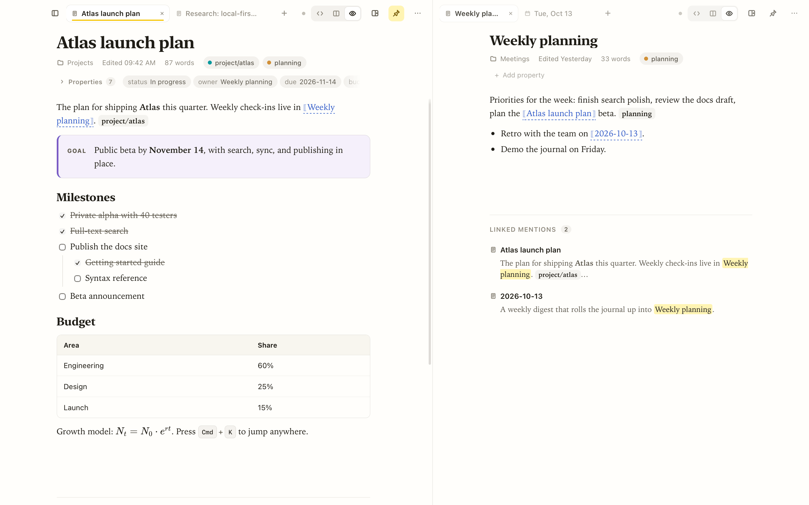
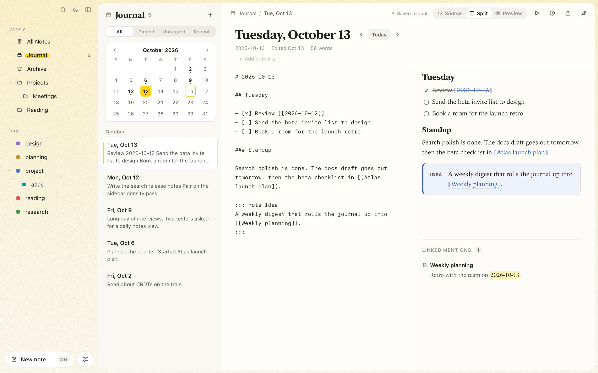
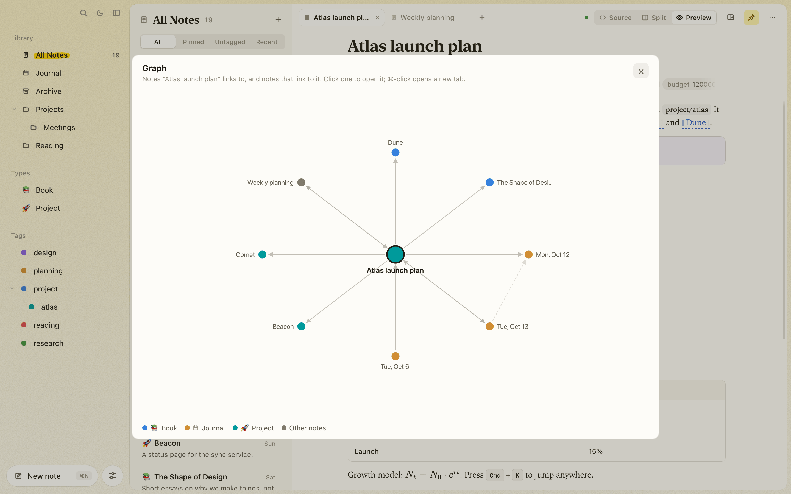

# Get to know Tagdown

> A practical guide to writing, connecting, and sharing your notes. Start small and explore as you go.

A daily thought, a project plan, a collection of ideas. Tagdown gives them a home in plain Markdown files on your Mac, with a little extra structure when you need it.

These guides will help you find your way around, build a habit of taking notes, and make useful connections between them.

## Quick start

  <a class="guide-card" href="getting-started.html">
    

    
Your first noteInstall Tagdown and make yourself at home.

  </a>
  <a class="guide-card" href="writing-notes.html">
    

    
Find your writing flowExplore the editor, tabs, and preview.

  </a>
  <a class="guide-card" href="journal.html">
    

    
A page for every dayCapture thoughts and keep a daily journal.

  </a>
  <a class="guide-card" href="organizing.html">
    

    
Connect your ideasBring notes together with links and tags.

  </a>

## Go a little further

- [🧩 Tagdown syntax](syntax.md): Markdown, callouts, tabs, columns, math, and diagrams.
- [✅ Queries and tasks](queries-and-tasks.md): Find notes, build live views, and keep track of what needs doing.
- [📜 Version history](version-history.md): Look back at earlier versions and restore a snapshot.
- [🌐 Sharing your notes](sharing.md): Export a document, present slides, or publish a website.
- [⌨️ Keyboard shortcuts](keyboard-shortcuts.md): Keep your hands on the keyboard.
- [🤖 Command line and AI assistants](cli-and-mcp.md): Work with your vault through the CLI and MCP server.
- [🛠️ Development](development.md): Build Tagdown, run the tests, and contribute.

## Your notes stay yours

Notes are plain `.md` files in `~/Documents/Tagdown`. Open them in another editor, sync them with your preferred service, or keep them in git. Plain Markdown is always valid Tagdown.

Tagdown is an open-source macOS app built with Tauri, TypeScript, and Rust. You can [download the latest release](https://github.com/sthix/tagdown/releases/latest) or [explore the source on GitHub](https://github.com/sthix/tagdown).
