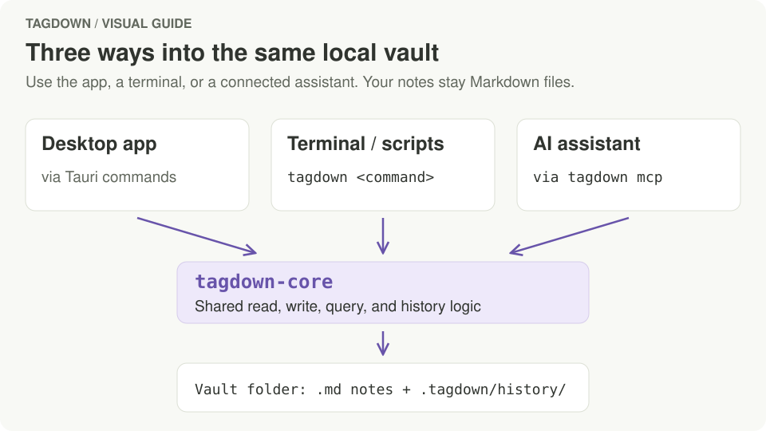

# Development

## Architecture

Tagdown Editor is a [Tauri v2](https://v2.tauri.app) app:

| Layer | Technology | Where |
| --- | --- | --- |
| UI | Vanilla TypeScript + Vite | `src/` |
| Tagdown parser and renderer | TypeScript, KaTeX, Mermaid | `src/tagdown/` |
| App commands | Rust (Tauri commands) | `src-tauri/src/commands/` |
| Vault, search, links, history, queries | Rust (`tagdown-core` crate) | `src-tauri/core/src/` |
| CLI and MCP server | Rust (`tagdown` binary) | `src-tauri/core/src/bin/tagdown.rs`, `src-tauri/core/src/mcp.rs` |

The UI never touches the filesystem directly; it calls Tauri commands, which go through `tagdown-core`. The CLI and MCP server use the same crate, so the app, the command line, and AI assistants all read and write notes the same way, with the same version history.

<figure class="doc-visual">
  <a href="images/guides/shared-vault.svg">
    
  </a>
  <figcaption>The three entry points share the Rust core. Changes to vault, query or history behavior belong there so every entry point gets the same behavior.</figcaption>
</figure>

The one thing that reaches the network is saving a web link (`weblink.rs`): it fetches the page with the system's `curl`, http and https only, so the app carries no HTTP or TLS stack of its own.

## Project layout

```text
.
├── src/
│   ├── main.ts             # app shell: sidebar, note list, editor, shortcuts
│   ├── commandPalette.ts   # ⌘K palette
│   ├── wikilinks.ts        # [[link]] resolution and autocomplete
│   ├── slashCommands.ts    # the / command menu
│   ├── listEditing.ts      # ↩, Tab and ⇧Tab in lists (continue, nest, renumber)
│   ├── blockDrag.ts        # drag-and-drop reordering of preview blocks
│   ├── queries.ts          # <query /> blocks (lists, tables, boards, cards) and the open-tasks view
│   ├── boardLanes.ts       # which lane a board card goes in, and moving it
│   ├── tableSelection.ts   # rows ticked in a table, for setting a property on all of them
│   ├── queryText.ts        # rewriting a query's text (sorting, columns)
│   ├── propertiesPanel.ts  # the properties panel and its value fields
│   ├── templateInheritance.ts # parent selection and inherited property switches
│   ├── typeHierarchy.ts    # nested type rows and descendant matching
│   ├── linkFields.ts       # properties that link to notes of another type
│   ├── taskRepeat.ts       # the next task of a repeating one
│   ├── journal.ts          # day keys, the journal calendar, appending to a page
│   ├── quickCapture.ts     # ⌥⌘J quick capture box
│   ├── localGraph.ts       # the ⌘⇧G graph of a note's links
│   ├── webLinks.ts         # saving a web link as a Link note (box and paste offer)
│   ├── localImages.ts      # images copied into attachments/ and loaded from the vault
│   ├── figures.ts          # the size and caption bar on figures
│   ├── history.ts          # version history dialog
│   ├── presentation.ts     # slides
│   ├── export.ts           # HTML export and print
│   ├── publish.ts          # static website publishing
│   ├── settings/           # settings dialog, theme, and editor preferences
│   ├── styles/             # CSS (tokens.css holds the light and dark palettes)
│   └── tagdown/            # parser, renderer, blocks, slides, syntax reference data
├── src-tauri/
│   ├── src/commands/       # Tauri commands called from the UI
│   └── core/src/           # vault, vaults, folders, frontmatter, properties,
│                           # search_index, links (backlinks, local graph), history,
│                           # tasks, query, types (inheritance), templates (built-ins),
│                           # journal (day pages, "This day"),
│                           # weblink (fetching pages for Link notes), watcher,
│                           # site, library, mcp
├── scripts/gen-syntax.mjs  # generates core/src/syntax.md from the reference data
├── tests/                  # Node tests for rendering, blocks, lists, slash commands, slides,
│                           # board lanes, table selection, journal, graph layout,
│                           # web links, figures, task repeats, syntax
└── docs/                   # this documentation
```

## Running checks

```sh
npm run build
cargo test --manifest-path src-tauri/Cargo.toml --workspace
cargo check --manifest-path src-tauri/Cargo.toml --workspace
node --test tests/*.mjs
```

## The syntax reference

The Tagdown reference has one source: `src/tagdown/documentation.ts`. It feeds the in-app **Settings → Tagdown Reference** and, through `npm run gen:syntax`, the generated `src-tauri/core/src/syntax.md` that the CLI and MCP server hand out. Run `npm run gen:syntax` after changing the reference; a test fails when the generated file is out of date.

## Previewing the documentation

The docs use Jekyll and a local layout in `docs/_layouts/default.html`. Navigation lives in `docs/_data/navigation.yml`; styles and browser interactions live in `docs/assets/`.

With Ruby and Bundler installed, run from the repository root:

```sh
cd docs
bundle install
bundle exec jekyll serve
```

Open `http://localhost:4000/tagdown/`. To check a production build, run `bundle exec jekyll build`. GitHub Pages builds the same `docs/` directory when changes reach `main`.

The explanatory diagrams in `docs/images/guides/` are SVGs generated from `scripts/gen-doc-visuals.mjs`. Edit that source and run `node scripts/gen-doc-visuals.mjs` to regenerate them. Keep screenshots for app controls and diagrams for relationships or before-and-after examples; add descriptive alt text and a caption wherever a visual needs explanation.

## Releasing

`.github/workflows/release.yml` builds a universal (Apple silicon + Intel) `.dmg` on GitHub Actions.

1. Bump the version in `src-tauri/tauri.conf.json`, `src-tauri/Cargo.toml`, and `package.json`, and commit.
2. Tag the commit and push the tag: `git tag v0.2.0 && git push origin v0.2.0`. The tag must match the `tauri.conf.json` version, or the build stops.
3. The workflow attaches the `.dmg` to a **draft** release named after the tag. Check it under **Releases**, edit the notes, and publish.

To try the build without releasing anything, run the workflow by hand (**Actions → Release → Run workflow**). The `.dmg` shows up as a workflow artifact.

### Signing and notarization

Without Apple credentials the app is ad-hoc signed, and users get past Gatekeeper with **Open Anyway** (see the README). With an [Apple Developer Program](https://developer.apple.com/programs/) membership, add these repository secrets (**Settings → Secrets and variables → Actions**) and the next build is signed and notarized, with no Gatekeeper warning:

| Secret | Value |
| --- | --- |
| `APPLE_CERTIFICATE` | Your **Developer ID Application** certificate exported from Keychain Access as `.p12`, base64-encoded: `base64 -i cert.p12 \| pbcopy` |
| `APPLE_CERTIFICATE_PASSWORD` | The password you set when exporting the `.p12` |
| `APPLE_SIGNING_IDENTITY` | The certificate name, e.g. `Developer ID Application: Jane Doe (AB12CD34EF)`; `security find-identity -v -p codesigning` lists it |
| `APPLE_ID` | The Apple ID email of your developer account |
| `APPLE_PASSWORD` | An [app-specific password](https://support.apple.com/102654) for that Apple ID, not your account password |
| `APPLE_TEAM_ID` | Your 10-character team ID from [developer.apple.com/account](https://developer.apple.com/account) |

The certificate pair turns on signing; the three `APPLE_ID…` secrets add notarization. Once a signed build ships, drop the Gatekeeper steps from the README.

## Conventions

- Commits follow [Conventional Commits](https://www.conventionalcommits.org): `feat(scope): …`, `fix: …`, `docs: …`, `style(ui): …`.
- Notes stay plain Markdown files. New features should keep the vault readable without the app.
- See [`PROJECT_PLAN.md`](https://github.com/sthix/tagdown/blob/main/PROJECT_PLAN.md) for the roadmap.
