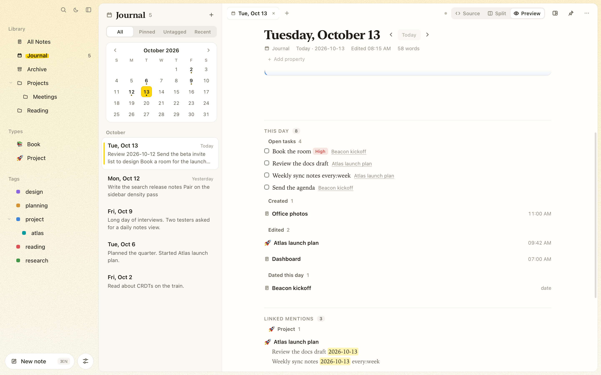

# Journal

The journal gives every day its own page, in the spirit of Logseq's journals. Open it, and today's page is ready to write in. Use it for a running log, meeting notes, or quick thoughts you'll sort out later.

<picture>
  <source media="(prefers-color-scheme: dark)" srcset="images/journal-dark.png" />
  
</picture>

## Today's page

- Click **Journal** in the sidebar, or press **⌘⇧J** from anywhere. Today's page opens, and is created if it doesn't exist yet.
- The note list shows a month calendar above your days, newest first. Days with a page have a dot. Click any day, past or future, to open or start its page.
- On a journal page, **‹** and **›** next to the date step to the previous and next day (**⌥⌘←** / **⌥⌘→**). **Today** jumps back.

Journal pages are ordinary notes: they show up in **All Notes**, and search, tags, tasks, queries, backlinks, version history and export all work on them. The Journal is a view of just the days, ordered by date.

## Linking to a day

A day's page is titled with its date in `YYYY-MM-DD` form, so `[[2026-10-13]]` links to it.

- Type `[[today`, `[[yesterday` or `[[tomorrow` and the link autocomplete offers that day's date.
- Clicking a link to a day without a page starts that page.
- **Linked mentions** at the bottom of a day lists every note that links to it. Writing "Call the bank on [[2026-10-20]]" in any note puts that line under October 20.

## Quick capture

Press **⌥⌘J** from any app while Tagdown is running (or choose **Quick capture** in the command palette). A floating capture bar appears above your windows, including across Spaces and fullscreen apps. Type, press **↩**, and it's added to the end of today's page, which is started if needed. **⇧↩** adds a new line; tick **As a task** to add it as an open task. **Esc** dismisses the bar and keeps your draft for next time. Closing the editor window keeps capture available; **⌘Q** quits Tagdown.

A capture that's a list item, like `- Call Sam`, joins the list at the end of the page instead of starting a new one. From the terminal, `tagdown today "- Call Sam"` does the same.

## What happened that day

Below a day's page, **This day** collects the rest of the day from across the vault:

- **Open tasks** whose day is this one (their first `[[YYYY-MM-DD]]` link). Tick them right there.
- **Created**: notes you started that day, with the time.
- **Edited**: older notes you last changed that day. A note edited again later moves to that later day.
- **Dated this day**: notes with a date property set to the day, such as `date: 2026-10-13` on a meeting note.

Click any of them to open it. **Linked mentions** follows below.

<picture>
  <source media="(prefers-color-scheme: dark)" srcset="images/journal-day-dark.png" />
  
</picture>

## A template for new days

The built-in **Journal Template** is ready when you open a vault. Open it from **Settings → Templates → Journal → Edit**, or right-click **Journal** under **Types** and choose **Edit template**. Each new day's page starts with its properties and body (everything after the title heading); the template's icon stays with the type. These placeholders are filled in:

<!--  -->

| Placeholder | Becomes |
| --- | --- |
| `{{date}}` | The day, e.g. `2026-10-13` |
| `{{yesterday}}` | The day before (`[[{{yesterday}}]]` links to it) |
| `{{tomorrow}}` | The day after |
| `{{weekday}}` | The day's name, e.g. `Tuesday` |

```markdown
# Journal Template

## {{weekday}}

- [ ] Review [[{{yesterday}}]]

### Notes
```

<!--  -->

Changing the template only affects pages created afterwards. In **Settings → Templates**, turn Journal off to start future days with an empty page, or use **Reset** to restore the starter template. Existing journal pages are kept. Your previous Journal Template, if you already had one, is preserved when built-in templates are introduced. See [template settings](organizing.md#built-in-templates).

## On disk

A journal page is a normal note file with one extra frontmatter line:

```markdown
---
id: 9a1e…
title: 2026-10-13
…
journal: 2026-10-13
---

# 2026-10-13
```

A note titled with a bare date, such as a daily note brought over from Obsidian or Logseq, becomes that day's page the first time you open the day.

## From the command line and AI assistants

`tagdown journal` prints today's page, and `tagdown journal "text"` appends to it. Name a day with `YYYY-MM-DD`, `yesterday` or `tomorrow`. The MCP server offers `read_journal` and `append_to_journal`. See [Command line and AI assistants](cli-and-mcp.md).
