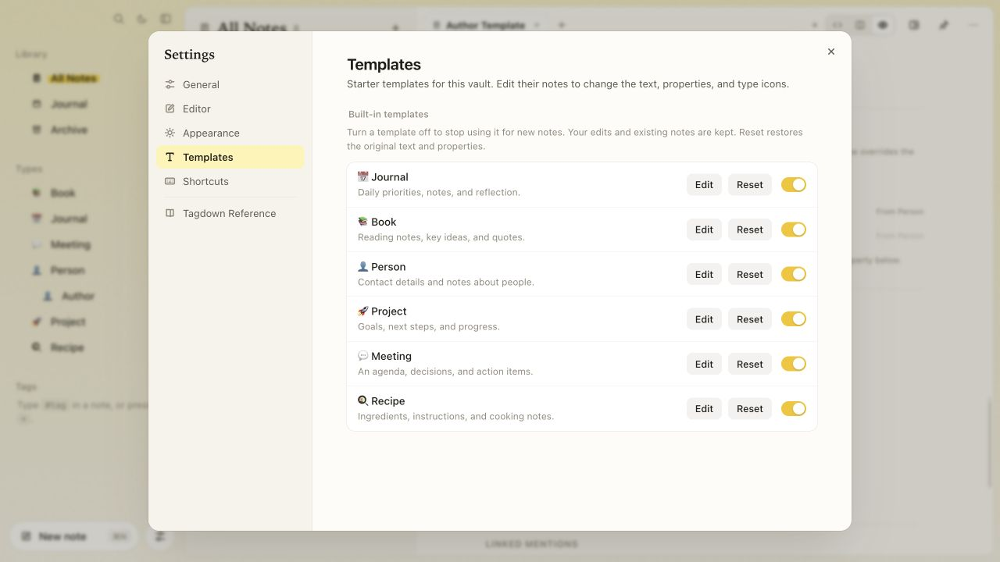
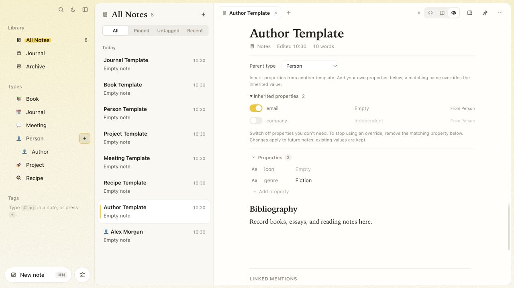
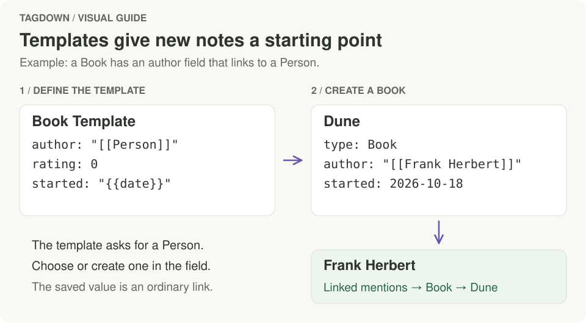

# Organizing your vault

## Where notes live

Your vault is `~/Documents/Tagdown` unless you choose another folder (see [More than one vault](#more-than-one-vault)). Every Markdown file in it is a note, and every folder in it is a folder in Tagdown. Notes Tagdown creates are named `note-<id>.md` and carry a small frontmatter block Tagdown maintains for you:

```markdown
---
id: 4f2c…
title: Atlas launch plan
tags: [project/atlas, planning]
starred: true
folder_id: projects
created: 2026-10-03T09:12:00Z
updated: 2026-10-12T09:42:00Z
---
# Atlas launch plan
…
```

Markdown files from elsewhere (an Obsidian vault, say) show up as they are, titled by their first `# ` heading or else their file name. Their own frontmatter is kept; Tagdown adds its fields the first time it saves one, and never touches a file you only read. Hidden folders such as `.git` or `.obsidian` are skipped, and so is a folder that's a vault of its own.

Folder icons, sidebar order and tag colours are recorded in `.tagdown/vault.json`. Because notes are ordinary files, you can back the vault up, sync it, or keep it in git. Changes made outside the app, notes and folders alike, are picked up while it runs.


## More than one vault

A vault is any folder Tagdown keeps notes in, and you can have several: one for work, one for home, one on an external drive. In **Settings → General → Vault**, click **Open folder as vault…** and pick a folder; an empty or existing folder becomes a vault the first time you open it. Every vault you've opened stays in the list, and **Open** next to one switches to it. ⌘K finds the same commands: *Switch to vault …* and *Open folder as vault…*.

Switching restarts Tagdown in the other vault, after saving whatever you were writing. Removing a vault from the list (the × on hover) only forgets it; its files stay where they are. The `tagdown` CLI and MCP server use whichever vault the app opened last.

## Folders

- Folders are directories in the vault. Creating, renaming, nesting or deleting one in Tagdown does the same on disk, and a folder you make in Finder appears in the sidebar.
- Create a folder from the sidebar's **Library** section. Folders can be nested.
- Drag a folder onto another to nest it, or between two folders to reorder.
- New notes are created in the selected folder, and moving a note to another folder moves its file. Archived notes live in `Archive/`.
- Deleting a folder moves its notes to the top of the vault. A folder that also holds other files (images, PDFs) isn't deleted; move those out in Finder first.
- **All Notes** shows every note that isn't archived, [journal](journal.md) pages included.

## Tags

Write `#tag` anywhere in a note, or `#parent/child` for a nested tag. Tags written in the text are collected into the note's frontmatter when it saves, and are lowercased.

The sidebar shows tags as a tree. Click a tag to list its notes; a parent tag includes the notes of its children. You can also create a tag from the sidebar and pick one of seven colours for it. Tags without a chosen colour get one automatically.

## Note types

A note can say what kind of thing it is: a book, a person, a project, a meeting. Its type is a `type:` [property](writing-notes.md#properties), so it stays plain YAML in the file:

```yaml
type: Book
```

The sidebar's **Types** section lists every type in the vault with how many notes have it. Child types are nested under their parent, whose count and note list include its children. Click a type to list its notes; **New note** (⌘N) there creates a note of that type. The command palette has a **New Book** action for each type, too. **Journal** appears here as well: its template starts new daily pages, and **New Journal** opens today's page.

### Built-in templates

Tagdown supplies **Journal**, **Book**, **Person**, **Project**, **Meeting**, and **Recipe** templates when the desktop app opens a vault. They are regular notes you can edit. Existing templates with the same names are kept, including their text and properties.

Open **Settings → Templates** to manage them for the current vault:

| Control | What it does |
| --- | --- |
| **Edit** | Opens the template note to change its text, properties, and icon. |
| **On/off switch** | Stops using the template for new notes, while keeping its note and your edits. Turn it back on to use your version again. |
| **Reset** | After confirmation, restores the template's original text and properties. Its on/off state is kept. |

These controls leave notes already created from the template unchanged. An unused type disappears from Types when its template is off; a type with existing notes stays available. Switching a parent template off does not remove the properties its children inherit. Archived or deleted templates stay removed until you explicitly restore them.

<figure class="doc-visual">
  <picture>
    <source media="(prefers-color-scheme: dark)" srcset="images/templates-dark.jpg" />
    
  </picture>
  <figcaption>Template settings belong to the open vault. Turning a template off preserves your version; Reset restores the starter content.</figcaption>
</figure>

### Templates

A note titled after the type plus "Template" (**Book Template**, **Person Template**) says how new notes of that type start:

- its **properties**, with their values, so every Book gets `author`, `rating` and `started` (a property can also [link to another type](#links-to-other-types));
- its **text** below the title;
- its **`icon:`** property, an emoji, is the type's icon in the sidebar and the note list. It isn't copied into new notes.

<!--  -->

In the template, `{{title}}`, `{{date}}`, `{{weekday}}`, `{{yesterday}}` and `{{tomorrow}}` are filled in for each new note, in the text and in property values (`started: "{{date}}"` becomes that day's date).

```tagdown
---
icon: 📚
author: "[[Person]]"
rating: 0
started: "{{date}}"
---

# Book Template

## Why I picked up {{title}}

## Notes
```

<!--  -->

Press **+** next to **Types** to start a type: it creates the template note with an empty `icon` for you. Right-click a type to edit its template or make one.

### Child types

An **Author** can be a child of **Person**, sharing its contact fields while adding author-specific information.

1. Hover **Person** in **Types** and click the **+** on its row. The button also appears when the row has keyboard focus. The **+** beside the Types heading creates a separate top-level type.
2. Enter **Author** and press **↩**. The new Author Template opens, with **Parent type: Person** already chosen. You can also right-click Person and choose **Create child type…**.
3. Keep the inherited fields you need and switch others off. For example, keep `email` and turn `company` off.
4. Use **Add property** below to add `genre`. Adding a property with the same name as an inherited one overrides its default for Author; remove that own property to use the inherited version again.

<figure class="doc-visual">
  <picture>
    <source media="(prefers-color-scheme: dark)" srcset="images/child-types-dark.jpg" />
    
  </picture>
  <figcaption>A child keeps its own type and body text. Its parent supplies property defaults and, unless overridden, its icon.</figcaption>
</figure>

You can choose another **Parent type**, or **None**, in any template. Several levels work: Novelist can inherit from Author, which inherits from Person. A type cannot be its own ancestor. If a parent is archived or removed, the child shows an error until you restore the parent or choose another one.

Parent edits flow into future child notes. Existing notes keep their values, including properties you later switch off in the template. Giving an existing note a child type adds only the enabled properties it lacks. Selecting Person, querying `type:Person`, or choosing a Person in a link field also includes Author and other descendants.

Inheritance stays in plain YAML on the template note:

```tagdown
---
extends: Person
exclude: [company]
genre: Fiction
---
# Author Template

## Bibliography
```

`extends` names the parent (`"[[Person]]"` works too); `exclude` lists inherited properties to leave out. Neither setting is copied into new notes.

### Links to other types

A template property whose value is a link to a type says that the property holds notes of that type. In the Book Template above, `author: "[[Person]]"` makes `author` a link to a Person, and `readers: ["[[Person]]"]` would hold a list of them:

- new Books start with `author` empty, and the field reads **A Person**;
- typing in it suggests your Person notes; pick one, or type a new name and press ↩ to create a Person note by that name (from the Person Template);
- the value is saved as a `[[link]]`, so the author's note lists the book under **Linked mentions**, where mentions are grouped by type.

Giving an existing note a type (by setting its `type` property) adds the template's properties it doesn't have yet. Its text is left alone.

<figure class="doc-visual">
  <a href="images/guides/note-types.svg">
    
  </a>
  <figcaption>The template supplies the fields; each new note supplies its values. Choosing an author creates a normal wikilink, which also connects the notes through backlinks.</figcaption>
</figure>

### Types in queries

`type:Book` in a [query](queries-and-tasks.md) lists notes of that type, the same as `type=Book`. A [table, board or cards](queries-and-tasks.md#tables-boards-and-cards) for a type adds new notes from its template:

```tagdown
<query type:Book show:cards columns:author,rating sort:-rating />
```

### Saved web links

To keep a page from the web, paste its link on an empty line and click **Save as Link note** in the bar that appears, or choose **Save web link…** in the command palette.

Tagdown fetches the page once and makes a note of type **Link**: titled with the page's title, with a `url:` property (and `site:` when the page names its site), the page's description as a quote, and the article's opening paragraphs. A pasted link becomes a link to the new note. Saving a link you saved before opens the note you already have.

A **Link Template** note works like any other type's template: its properties and body are added to each new Link note, say `read: false` and a "## Why I saved it" heading. When the page can't be read (you're offline, or it isn't a web page), the note gets the address only.

The page is fetched with your Mac's own `curl`, over http or https only. Nothing else leaves your Mac.

## Pinning and filters

Pin a note with the pin button in the editor's top-right corner. The pills above the note list filter the current view:

| Filter | Shows |
| --- | --- |
| All | Everything in the current folder or tag |
| Pinned | Pinned notes only |
| Untagged | Notes without any tags |
| Recent | The ten most recently edited notes |

## Archive and delete

Deleting a note moves it to the **Archive** after a confirmation. Archived notes stay on disk but are left out of All Notes, search, and queries. Deleting a note from inside the Archive removes it for good.

## Search

Open search with **⌘K** or the magnifier in the sidebar. Search is full text, backed by a [Tantivy](https://github.com/quickwit-oss/tantivy) index in `.tagdown/search.idx/`, and ignores accents.

| Query | Matches |
| --- | --- |
| `budget review` | Notes containing both words (the last word also matches as a prefix while you type) |
| `"launch plan"` | The exact phrase |
| `title:atlas` | Notes with *atlas* in the title |
| `tag:project` | Notes tagged `project` or any tag below it, such as `project/atlas` |
| `-draft` | Excludes notes containing *draft* (works with `-tag:` and `-title:` too) |

Results show highlighted excerpts. The same syntax works in [queries](queries-and-tasks.md) and the [`tagdown search`](cli-and-mcp.md) command.

## Wikilinks and backlinks

- `[[Note title]]` links to another note by title (case-insensitive). Typing `[[` opens autocomplete.
- Clicking a link opens the note. If no note has that title yet, Tagdown creates it.
- `[[Note title#Heading]]` jumps to a heading; `[[Note title|label]]` shows a different label.
- A link can also name a note by its file, the way Obsidian writes them: `[[blog/my-post]]` for `blog/my-post.md`, or just `[[my-post]]` when no other note has that file name. A note whose title matches wins over a file match.
- When you rename a note, links to it by title are updated automatically. Links that name it by its file still find it, so they're left as they are.
- Below each note, **Linked mentions** lists the notes that link to it, with the lines that mention it.

### Graph

Press **⌘⇧G** (or choose **Show graph** in the command palette) to see the open note in the middle of the notes it links to and the notes that link to it. Each note is colored by its [type](#note-types), journal pages in amber and plain notes in grey; the legend at the bottom names them. Arrows point the way a link goes. Dashed lines are links among the neighbours themselves.

Point at a note to bring out its links. Click it to open it, or ⌘-click to open it in a new tab. Links in properties count too, so a Book's `author: "[[Ursula K. Le Guin]]"` shows up. With very many neighbours, the graph keeps the 48 most recently edited.

<picture>
  <source media="(prefers-color-scheme: dark)" srcset="images/local-graph-dark.png" />
  
</picture>
