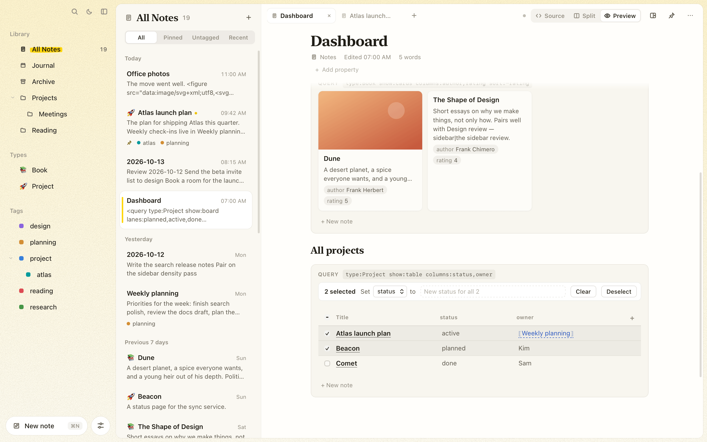

# Queries and tasks

## Live queries

A `<query />` block lists notes or tasks from across the vault that match a search. The list is computed when the note renders and refreshes as notes change.

```tagdown
## Open project tasks

<query tag:project show:tasks />

## Recently edited in Work

<query folder:Work sort:updated limit:5 />
```

The query uses the [search syntax](organizing.md#search) (words, `"phrases"`, `tag:`, `title:`, `-exclusions`) plus these options:

| Option | Values | Default |
| --- | --- | --- |
| `show:` | `notes`, `tasks`, `table`, `board`, `cards` | `notes` |
| `status:` | `open`, `done`, `all` (for tasks) | `open` |
| `sort:` | `updated`, `created`, `title`, or a property (`sort:due`, `sort:-priority` for descending); for tasks, `date` or `priority` | `updated` |
| `folder:` | A folder name; quote names with spaces | All folders |
| `type:` | A [note type](organizing.md#note-types), like `type:Book` | All types |
| `columns:` | Properties to show in a table, on board cards or on cards | The ones the query uses |
| `group:` | The property a board's lanes are values of | `status` |
| `lanes:` | A board's lanes, in order, like `lanes:todo,doing,done` | The values notes use |
| `date:` | For tasks: `today` (and overdue), `overdue`, `upcoming`, `week`, `none`, `any`, or a day like `2026-10-20` or `today+1` | Any |
| `priority:` | For tasks: `high`, `medium`, `low` | Any |
| `limit:` | A number up to 500 | 50 |

A note never lists itself. When a query shows tasks, ticking one in the list ticks it in the note it lives in.

## Filtering by property

Queries filter on a note's [properties](writing-notes.md#properties):

| Filter | Matches |
| --- | --- |
| `status=active` | The value, without case; a list holding it; a link by its title |
| `status!=done` | Notes whose value isn't that, including notes without it |
| `priority=2..`, `due=..today+7` | Ranges of numbers or dates, either end open; `today`, `today+N`, `today-N` |
| `has:owner`, `-has:owner` | Notes with (or without) a value |

```tagdown
## Due this week

<query status=active due=..today+7 sort:due />
```

## Tables, boards and cards

Three views show the matching notes with their properties, and each can add a note that already matches the query: in its folder, with its tags and the values its `key=value` filters ask for. For a `type:`, the new note starts from the type's [template](organizing.md#templates).

**`show:table`** lists the notes with a column per property. Edit a cell to change that note's property, click a header to sort, × hides a column and + adds one. These rewrite the query in the note, so the view stays plain text.

To change several notes at once, tick their rows (shift-click ticks every row between the last one and this one, the header box ticks all). A bar above the table then sets a column's value on all of them, or **Clear** removes it from them.

<picture>
  <source media="(prefers-color-scheme: dark)" srcset="images/table-bulk-dark.png" />
  
</picture>

```tagdown
<query tag:project show:table columns:status,owner,due sort:due />
```

**`show:board`** puts the notes in a lane per value of one property, `status` unless `group:` names another. Drag a card to another lane to change that note's property; for a list property, the card swaps the one item. Notes without a value go in a last lane, and dragging a card there clears the property. `lanes:` fixes the lanes' order and shows lanes no note uses yet; **+ Lane** adds one by writing `lanes:` into the query. **+ New** in a lane adds a note with that lane's value.

```tagdown
<query type:Project show:board lanes:planned,active,done columns:owner,due />
```

**`show:cards`** shows a grid of cards with each note's cover image, opening lines, and the properties `columns:` names. The cover is the note's `cover:` property (a path in the vault or a URL), or else the first image in the note.

```tagdown
<query type:Book show:cards columns:author,rating sort:-rating />
```

Queries are also evaluated when you [export, publish, or present](sharing.md) a note, so the output contains the list as it was at that moment.

## Tasks

A task is any list item written as `- [ ]` (open) or `- [x]` (done):

```tagdown
- [x] Private alpha with 40 testers
- [ ] Publish the docs site
```

Click a checkbox in the preview to tick it; the source is updated for you.

### Days, priorities and repeats

A task can carry a few words that Tagdown reads, all plain text:

```tagdown
- [ ] Send the beta invite list [[2026-10-20]] !high
- [ ] Water the plants [[2026-10-18]] every:week
- [ ] Read the CRDT paper !low
```

- **Its day** is the first date link in it. The date link also puts the task on that day's [journal page](journal.md), under *This day* while it's open and under *Linked mentions*. The preview shows it as *Today*, *Tomorrow* or *Tue, Oct 20*, highlighted when it's today or overdue. Type `/date` to insert today's date and change it.
- **Its priority** is `!high`, `!medium` or `!low`, shown as a flag.
- **`every:day`**, `every:weekday`, `every:week`, `every:month` or `every:year` makes it **repeat**. Ticking it adds the next one above it, with its day moved on (a task without a day repeats from today). The ticked one stays as a record.

Queries list tasks by day with `date:` and `sort:date`:

```tagdown
## Today

<query show:tasks date:today sort:date />

## This week, most important first

<query show:tasks date:week sort:priority />
```

Sorted by `date`, the list is grouped by day (overdue tasks together at the top) and each task names its note.

## The open-tasks view

Press **⌘⇧T** (or choose **Show open tasks** in the command palette) to see the vault's unticked tasks:

| View | Shows |
| --- | --- |
| Today | Tasks due today, with overdue ones first |
| Upcoming | Tasks with a later day, grouped by day |
| Inbox | Tasks without a day, most important first |
| All | Every open task, grouped by note |

Tick tasks off right there, or click a note to open it. The view you chose last is kept while the app runs.

From the command line, `tagdown tasks` prints the same list; see [Command line and AI assistants](cli-and-mcp.md).
