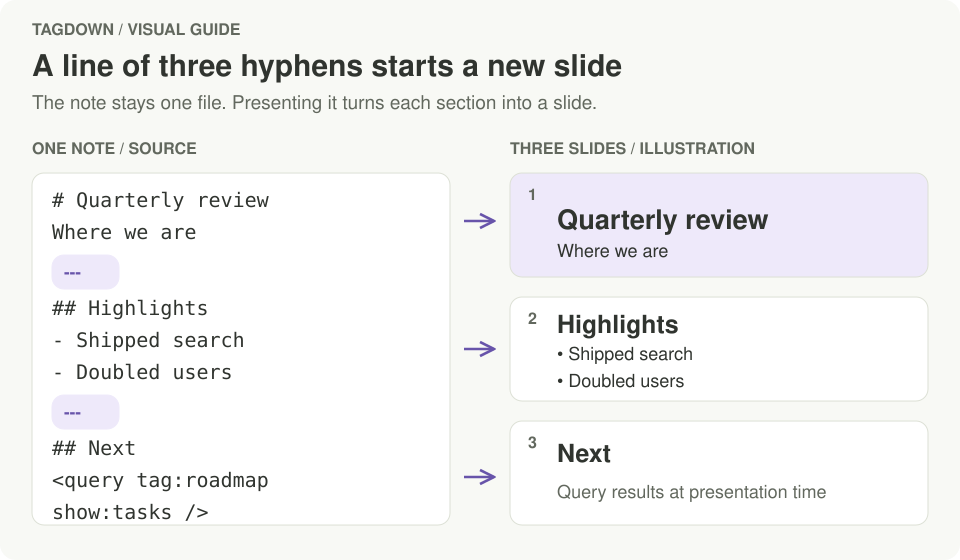
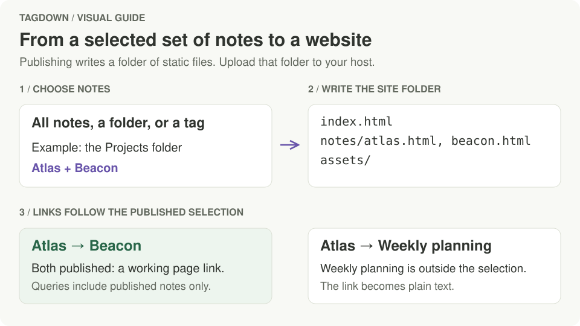

# Sharing your notes

Every way out of Tagdown renders the note with the same parser as the preview, so what you see is what you share. Exports always use the light theme, so a document looks the same on paper, on screen, and in someone else's browser.

The **Export** button (the share icon in the editor's top bar) collects these options.

## Export as HTML

**⌘⇧E** saves the open note as a single, self-contained `.html` file. It carries its own styles (and the KaTeX fonts when the note has math), so it opens in any browser without the app. Query blocks are filled in with their results at the moment of export.

## Print or save as PDF

**⌘P** opens the macOS print dialog with a print layout of the note. Choose **Save as PDF** to get a PDF. Headings stay with the text that follows them, and code blocks, tables, and figures avoid breaking across pages where possible.

## Present as slides

**⌥⌘P** (or the play button) presents the open note full screen.

- Each line that is only `---` starts a new slide (not inside code blocks).
- A slide with only headings and a short line is centred as a title slide.
- Slides scale to fit any screen.

```tagdown
# Quarterly review

Where we are

---

## Highlights

- Shipped search
- Doubled users

---

## Next

<query tag:roadmap show:tasks />
```

<figure class="doc-visual">
  <a href="images/guides/slide-breaks.svg">
    
  </a>
  <figcaption>Two breaks make three slides. The query on the last slide is filled with its results when you present the note. The slide layouts here are illustrations.</figcaption>
</figure>

| Key | Action |
| --- | --- |
| → ↓ Space ↩ Page Down | Next slide |
| ← ↑ ⌫ Page Up | Previous slide |
| Home / End | First / last slide |
| Esc | Leave the presentation |

## Publish as a website

**Publish as website…** (in the Export menu or the command palette) turns notes into a static website: a folder of HTML files you can upload to any web host (GitHub Pages, Netlify, a plain server) or open straight from disk.

1. Choose what to publish: **all notes**, a **folder**, or a **tag**.
2. Give the site a title.
3. Click **Choose folder and publish…** and pick an output folder. When it's done you can open the site in your browser or show it in Finder.

<figure class="doc-visual">
  <a href="images/guides/publishing.svg">
    
  </a>
  <figcaption>Publishing creates files on your Mac. Upload the output folder to put the site online. Only notes in your selection become pages or query results.</figcaption>
</figure>

The output looks like this:

```text
index.html               every published note, with tag filters and search
notes/<slug>.html        one page per note, named after its title
assets/style.css         the preview's look, with math fonts embedded
assets/site.js           search and tag filtering
assets/search-index.js   the search data
```

What to know:

- **Links between published notes** become links between pages, and each page lists the published notes that link to it.
- **Links to notes that aren't published** become plain text, so the title of a private note never leaks.
- **Queries** show only published notes. Tables, boards and cards appear as they look in the app, without editing.
- **Republishing** to the same folder replaces the previous publish and removes pages for notes that are no longer included. Tagdown only deletes files it wrote itself, as recorded in its own manifest.
- If the folder isn't empty, Tagdown asks before publishing into it. An empty folder keeps things tidy.
