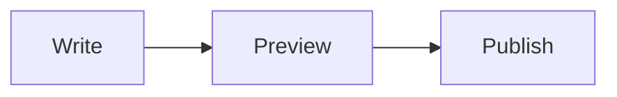

# Tagdown syntax

Tagdown is Markdown plus a small tag layer. Plain Markdown is always valid Tagdown; reach for the extras when they make a note clearer.

This page is a quick tour. The complete reference, with every attribute and an example for each component, is [`src-tauri/core/src/syntax.md`](../src-tauri/core/src/syntax.md). It is generated from the same source as the app's **Settings → Tagdown Reference** and the reference the MCP server gives AI assistants, so it is always current.

## Notes, tags, and links

```tagdown
# Atlas launch plan

The plan for shipping **Atlas** this quarter. #project/atlas #planning

Weekly check-ins live in [[Weekly planning]], or [[Weekly planning|the weekly note]].
```

- The first `# ` heading is the note's title.
- `#tags` anywhere in the text tag the note. Use `/` to nest them: `#project/atlas` sits under `project` in the sidebar.
- `[[Title]]` links to another note; `[[Title|label]]` shows a different label; `[[Title#heading]]` jumps to a heading.

## Inline formatting

```tagdown
**bold**, *italic*, ==highlight==, ~~strike~~, `code`, H~2~O, E = mc^2^
[a link](https://example.com), https://example.com, <hi@example.com>
Press <keys>Cmd+K</keys> to search.
```

Straight quotes curl, `--` becomes an en dash, `---` an em dash, and `...` an ellipsis.

## Blocks

```tagdown
- [x] Done
- [ ] Still to do

| Feature | Syntax |
| --- | --- |
| Callout | `::: tip` |

Term :: Definition
Another term :: Another definition

Tagdown is small[^1].

[^1]: Footnotes are collected at the bottom.
```

## Callouts

Types are `info`, `warn`, `error`, `ok`, and `tip`. GitHub-style names (`note`, `warning`, `caution`, `important`, `danger`) work as aliases.

```tagdown
::: tip Pro tip
Use callouts for warnings, notes, and side comments.
:::

<note warn "Careful">
This changes the rendered output.
</note>
```

## Layout and structure

```tagdown
<toc />

<grid 2>
Left column.
|||
Right column.
</grid>

<tabs>
<tab "Source">
The raw text.
</tab>
<tab "Preview">
The rendered document.
</tab>
</tabs>

<details "Read more">
Hidden until opened.
</details>

<aside right>
A side note that floats beside the text on wide screens.
</aside>
```

`</>` closes the most recent open tag, so you don't have to repeat its name.

## Code, math, and diagrams

````tagdown
<code python file=hello.py lines hl=2>
def greet(name):
    print(f"Hello, {name}!")
</code>

Inline math $a^2 + b^2 = c^2$, or a block:

$$\int_0^1 x^2 \, dx = \frac{1}{3}$$


````

Math is rendered with KaTeX and diagrams with Mermaid.

## Media

```tagdown
<figure src=diagram.png caption="System diagram" />

<quote "Grace Hopper">
The most dangerous phrase is: we have always done it this way.
</quote>

<embed url=https://youtu.be/dQw4w9WgXcQ />
```

YouTube and Vimeo embeds show a thumbnail that opens the video in your browser.

## Queries and slides

```tagdown
<query tag:project show:tasks />
```

A `<query />` lists matching notes or tasks from the whole vault and stays up to date. See [Queries and tasks](queries-and-tasks.md).

A line containing only `---` starts a new slide when you present a note. See [Sharing your notes](sharing.md#present-as-slides).
