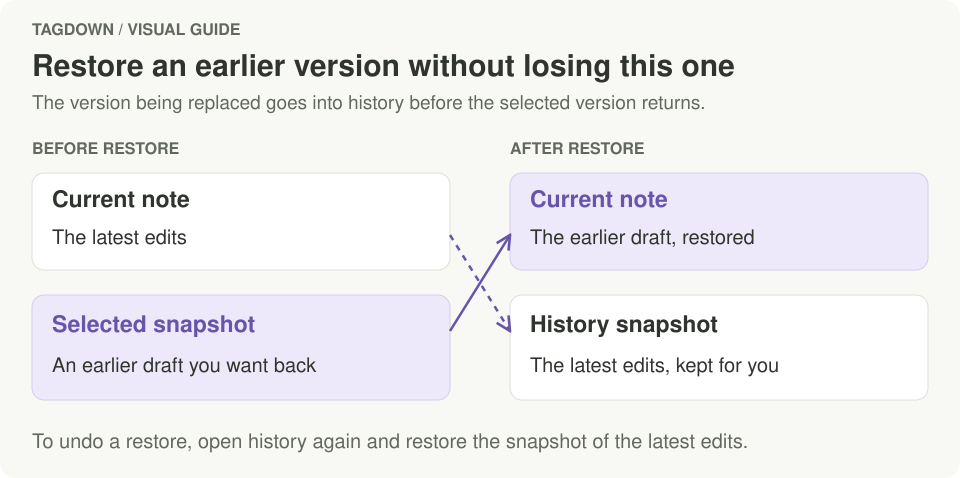

# Version history

Tagdown keeps earlier versions of every note on your Mac, so an accidental delete or a bad edit is never final.

## Viewing and restoring

Press **⌘⇧H**, click the clock button in the editor's top bar, or choose **Show version history** in the command palette. The dialog lists the note's earlier versions, newest first. Select one (arrow keys work) to see it rendered, then click **Restore this version**.

Restoring is itself undoable: the version you are replacing is saved to history first.

<figure class="doc-visual">
  
  <figcaption>Restoring makes the selected snapshot current. To reverse the restore, open history again and restore the snapshot containing the edits you replaced.</figcaption>
</figure>

## What gets kept

When a note saves, Tagdown keeps the version being replaced if the last snapshot is a few minutes old, or whenever the save removes most of the note. Over time, older snapshots are thinned out:

| Age | Kept |
| --- | --- |
| Last hour | Every snapshot |
| Last day | One per hour |
| Last month | One per day |
| Last year | One per week |

Snapshots are also taken before a note is changed from outside the app (by the `tagdown` CLI, an AI assistant through MCP, or a file changed on disk and reloaded).

## Where it's stored

History lives in `.tagdown/history/<note id>/` inside the vault. It is local only; nothing is uploaded anywhere.
