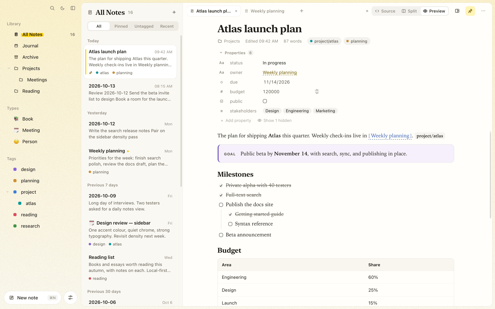
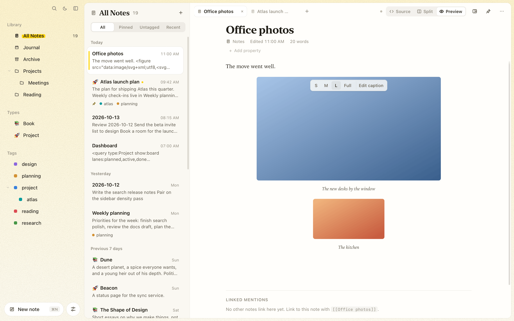
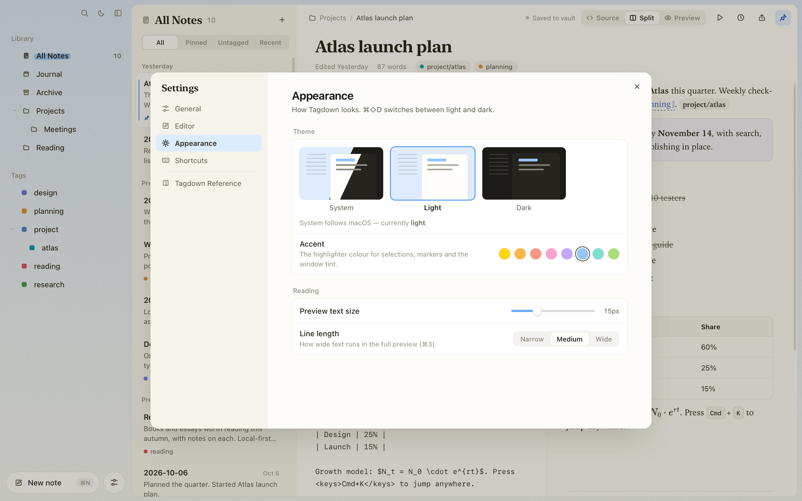
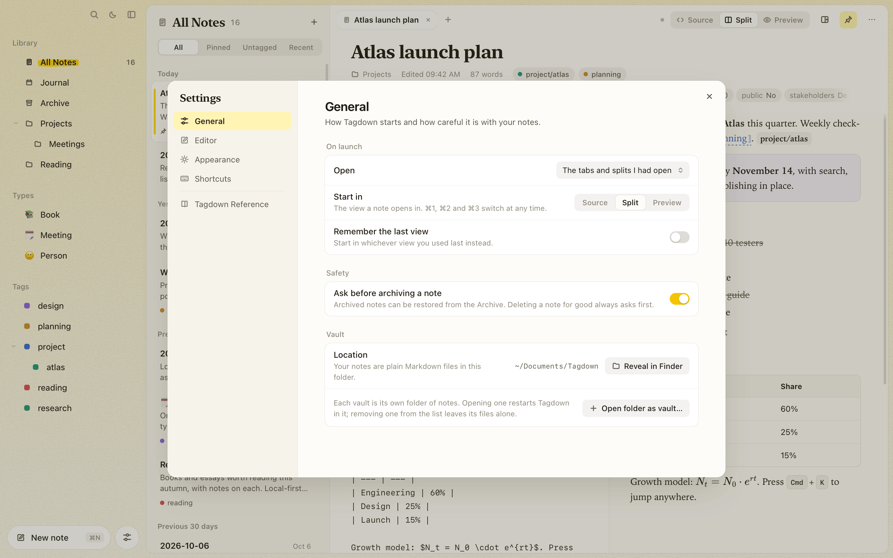

# Writing notes

## The workspace

The window has three areas:

1. **Sidebar.** The library (All Notes, Journal, Archive, and your folders), your [note types](organizing.md#note-types), and the tag tree. Search, the theme switch, and focus mode sit at the top; **New note** and **Settings** at the bottom.
2. **Note list.** Notes in the current folder or tag, grouped by date (Today, Yesterday, Previous 7 days, and so on). The pills at the top filter it: **All**, **Pinned**, **Untagged**, **Recent**.
3. **Editor.** The open notes as tabs, with save status, view switcher, and note actions. Rarer actions (export, publish, and in a narrow pane slides and history) sit in the **⋯** menu.

Press **⌘\\** for focus mode, which hides the sidebar and note list so only the note is left.

<figure class="doc-visual">
  <picture>
    <source media="(prefers-color-scheme: dark)" srcset="images/tagdown-editor-dark.png" />
    
  </picture>
  <figcaption>From left to right: choose a place in the sidebar, choose a note in the list, then write in the editor. The Source, Split and Preview buttons are above the note.</figcaption>
</figure>

## Tabs and panes

Clicking a note opens it in the current tab. To keep the note you're on open as well:

| To open a note… | Do this |
| --- | --- |
| In a new tab | **⌘-click** it (in the note list, a link, a backlink or the palette with **⌘↩**), middle-click it, or right-click → **Open in new tab** |
| Beside the current one | **⌥⌘-click** it, right-click → **Open to the right**, or drag it to the left or right edge of the editor |
| The same note twice | **⌥⌘\\** (Split right) opens the note you're in again beside it, say source on one side and preview on the other |

**⌘T** opens a new tab with the palette ready, so you can type the note's name and press ↩. **⌘W** closes the tab, **⌃⇥** / **⌃⇧⇥** go to the next and previous tab, and **⌃⌘←** / **⌃⌘→** move between panes.

Drag a tab to reorder it, onto another pane's tabs to move it there, or to the edge of a pane to put it in a new pane. Drag a note from the list onto a pane to open it in a tab there. The divider between panes resizes them; double-click it to even them out. You can have up to four panes. A note open in two panes stays in step: what you type in one shows in the other once it's saved.

Notes open in a tab somewhere have a small dot in the note list. Tagdown remembers your tabs and panes per vault and reopens them on launch (**Settings → General → On launch**).

<picture>
  <source media="(prefers-color-scheme: dark)" srcset="images/panes-dark.png" />
  
</picture>

## Properties

A note's properties (its frontmatter fields) sit under the title. When a note has more than three, they fold to one line of chips; click **Properties** (or press **⌘⇧I**) to open or fold them, and each note remembers your choice. Click a chip to jump straight to editing that value. **Settings → Editor → Fold properties** sets when they start folded: always, never, or when there are more than three.

Properties are typed: text, numbers, true/false, dates (`2026-11-14`), lists, and `[[links]]`, which count as backlinks. Add one with **Add property** under the title or in the command palette (⌘K); they stay plain YAML in the note's frontmatter. A `type` property makes the note a [Book, Person or any other type](organizing.md#note-types), and [queries](queries-and-tasks.md#filtering-by-property) filter on properties and show them as tables, boards and cards.

Click the icon to the left of a property to change its field type. The same editors work in query tables:

| Field type | Editing and storage |
| --- | --- |
| Text / Long text | Short text or multiple lines. In long text, Enter inserts a line; ⌘Enter (Ctrl+Enter) saves. |
| Number / Currency | Numeric amounts. Currency uses the neutral `¤` symbol, without assuming a denomination or converting amounts. |
| Percent | Enter `75` for 75%; the file stores `0.75`. Numeric queries compare the stored fraction. |
| Duration | Enter hours:minutes:seconds, minutes:seconds, or a number of seconds. Stored as seconds; numeric queries use seconds. |
| Rating | Click one of five stars; click the current rating to clear it to zero. |
| Checkbox | True or false. |
| Date / Date and time | A calendar date, or a local date and time without a timezone. |
| URL / Email / Phone | An address with an action to open the browser, email client or phone app, plus a separate Edit control. |
| Single select / Multiple select | Pick from values already used for that property across the vault, or type a new option. Multiple select stores unique options and shows removable chips. |
| List | Comma-separated text or wikilinks. Quote an item containing a comma. |

Two property names do something special. **`icon`** gives the note its own emoji: click it to pick one, or type or paste any emoji (⌃⌘Space opens the macOS picker). It shows before the note's title in the note list, its tab, and linked mentions, in place of its [type's](organizing.md#note-types) icon; **Use the type's icon** clears it. **`alias`** or **`aliases`** gives the note [other names](organizing.md#aliases) to link by: type one name, or several separated by commas, and it's saved as text or a list.

Specialized types keep their choice in a YAML comment, for example `progress: 0.75 # tagdown:type=percent`. The underlying values remain ordinary YAML strings, numbers or lists, and types survive renaming, templates and reopening the vault. Nested YAML remains available as a read-only field. Created and updated times already belong to the note; linked records use `[[wikilinks]]` and [typed link fields](organizing.md#links-to-other-types).

Fields you rarely look at, such as an `id` or a sync timestamp, can be hidden in every note: hover the row and click the eye. **Show hidden** under the list brings them back for a moment; unhide them for good from the row, or in **Settings → Editor → Hidden properties**. Hiding only changes the view; the field stays in the file.

<picture>
  <source media="(prefers-color-scheme: dark)" srcset="images/properties-dark.png" />
  
</picture>

## Titles

A note's title is its first `# ` heading. Rename a note by editing that heading. If other notes link to it with `[[wikilinks]]`, Tagdown updates those links automatically once the new title settles (see [Organizing your vault](organizing.md#wikilinks-and-backlinks)).

## View modes

| Mode | Shortcut | What you see |
| --- | --- | --- |
| Source | ⌘1 | The raw Tagdown text |
| Split | ⌘2 | Source and rendered preview side by side |
| Preview | ⌘3 | Only the rendered document |

In **Preview**, you can still edit: click a block to edit its source in place. The open block gets a thin outline with a slowly moving highlight. Press **Esc** or **⌘↩** to finish. Ticking a checkbox in the preview updates the task in the source.

### Reordering blocks

To reorder blocks, hover one and drag the **⋮⋮** grip that appears in the left margin; a line shows where it will land, and **Esc** cancels. While editing a block, **⌘⇧↑** and **⌘⇧↓** move it past its neighbour. The note's title (and any frontmatter) always stays at the top.

A heading carries its whole section: everything under it, up to the next heading of the same or a higher level. With the keyboard, a heading steps past a whole sibling section at a time. To move headings on their own instead, turn off **Settings → Editor → Headings move their section**.

## Saving

Notes autosave shortly after you stop typing. **⌘S** saves immediately. The status next to the view switcher shows **Saved to vault** once the note is on disk.

If a note changes on disk while it is open (another editor, a `git pull`, a sync service, or the `tagdown` CLI), Tagdown reloads it. If you also have unsaved edits, it asks which version to keep. Either way, the version that gets replaced is kept in [version history](version-history.md).

## The command menu

Type **/** at the start of a line, or after a space, to open the command menu. Keep typing to filter it (`/h2`, `/todo`, `/callout`, `/table`), then press **↩** or **Tab** to apply the highlighted command, or **Esc** to close the menu and keep the text.

- **Basic blocks** turn the current line into a heading, bullet, numbered item, or task, and keep what you already wrote on it. Toggles, quotes, dividers, and tables are inserted too.
- **Components** (callouts, columns, tabs, images, code, math, diagrams, queries) replace an empty line, or go below the current one. The placeholder text is selected, so you can type straight over it.
- **Links and dates** insert a `[[` link (with the note autocomplete), a link to today's, tomorrow's, or yesterday's journal page, the current time, or a tag.
- **New note from template** (`/template`) creates a linked note in a new tab, with its title ready to edit.

### Create a linked note from a template

1. Put the caret where the link should go. In preview mode, click a block to edit it, or use the empty block at the end of the note.
2. Type `/template` and choose **New note from template**.
3. Search for a template, such as **Meeting**, and click it or press **↩**. The new note opens in a new tab with its template text and properties, and its title selected for editing.
4. Type a title, such as **Release planning**. When it saves, the original note's link changes from `[[New Meeting]]` to `[[Release planning]]`.

Switch back to the original tab to continue writing. The link stays at the insertion point, including when you started from an empty final block. The workflow is available in source, split, and preview modes.

The picker lists enabled note-type templates. Manage the built-in ones in **Settings → Templates**, or [create your own type](organizing.md#templates). Daily pages use the [Journal workflow](journal.md) and are not listed in this picker.

## Lists and outlines

Lists continue as you type. Press **↩** at the end of a bullet, a numbered item, or a task to start the next one; numbers count up, and new tasks start unticked. Press **↩** again on the empty item to end the list and go back to ordinary text.

Lists nest like an outliner. **Tab** makes the current item a child of the item above it, and takes its own children along. **⇧Tab** moves it back out. Nested items show a thin guide line in the preview, and numbered lists renumber themselves as items move. **⇧↩** adds a line inside an item without starting a new one.

## Images

Paste an image, drop one on the editor or the preview, or choose **Image** in the `/` menu to pick files. Each image is copied into the vault's `attachments/` folder and added to the note as a figure:

```tagdown
<figure src="attachments/Pasted image 2026-10-17 09.12.04.png" />
```

In the preview, point at a figure for a small bar: **S**, **M**, **L** and **Full** set its width to a third, half, three quarters or all of the text width (click the active one again for the image's own size), and **Add caption** puts a caption under it. Click a caption to change it; **↩** saves and **Esc** keeps the old one. The bar writes `size=` and `caption=` into the figure tag, so the note stays plain text.

<picture>
  <source media="(prefers-color-scheme: dark)" srcset="images/figures-dark.png" />
  
</picture>

Images written the Markdown way, ``, or the Obsidian way, `![[photo.png]]`, show up too, inline with the text. A number after `|` sets the width in pixels: `![[photo.png|300]]`. See [Media](syntax.md#media) for every option.

## The formatting toolbar

The floating toolbar at the bottom of the editor inserts headings, bold, italic, and code. Its **Components** menu inserts any Tagdown component (callouts, tabs, grids, figures, queries, math, diagrams, and more) as a ready-to-edit template.

## The command palette

**⌘K** opens the command palette. Type to jump to a note by title or search inside notes (the [search syntax](organizing.md#search) works here), or run any app action: switch views, export, present, show tasks or history, show a note's [graph](organizing.md#graph), [quick capture](journal.md#quick-capture) to today's journal, [save a web link](organizing.md#saved-web-links), change theme, and open settings. Use the arrow keys and **↩** to choose.

## Themes and accents

Tagdown has a light and a dark theme. **⌘⇧D** switches between them. In **Settings → Appearance** (⌘,) you can also choose **System** to follow macOS, and set the preview's text size, the **Title font** (serif, the default, or sans-serif for note titles and headings), and line length.

The **Accent** row picks the highlighter colour the whole app is tinted with, from sixteen: yellow (the default), lime, green, mint, teal, cyan, blue, indigo, purple, magenta, pink, red, coral, orange, peach, or graphite. It colours the marker behind the current sidebar item, text selection, the window's tint, and the app's controls, in both themes. **Paper grain** turns the faint texture on the window background on or off.

<picture>
  <source media="(prefers-color-scheme: dark)" srcset="images/appearance-dark.png" />
  
</picture>

## Settings

**⌘,** opens Settings. Everything there is saved on this Mac and applies right away.

<picture>
  <source media="(prefers-color-scheme: dark)" srcset="images/settings-dark.png" />
  
</picture>

- **General.** What opens on launch (the tabs and panes you had open, today's journal page, or the most recent note), which view a note starts in or whether to remember the last one, whether archiving a note asks first, and where your vault lives, with **Reveal in Finder**. Deleting a note for good always asks.
- **Editor.** Spellcheck, the size of the source text, when properties start folded, the properties hidden in every note, and **Headings move their section**, on by default, which decides whether dragging a heading takes the content under it along.
- **Appearance.** Theme, accent colour, paper grain, preview text size, title font, and line length.
- **Shortcuts.** Every keyboard shortcut, also listed in [Keyboard shortcuts](keyboard-shortcuts.md).

## The built-in reference

**Settings → Tagdown Reference** lists every Tagdown component with an example you can see rendered. It is the same reference as [Tagdown syntax](syntax.md).
