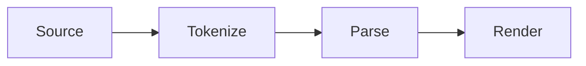

# Tagdown syntax

Tagdown is Markdown plus structure: tags, wikilinks, callouts, layout components, math, and diagrams. Plain Markdown is valid Tagdown; reach for the extras when they make a note clearer. A note starts with a `# Title` heading, which is its title; `#tags` anywhere in the text tag it, and `[[Note title]]` links to another note.

<!-- Generated from src/tagdown/documentation.ts by scripts/gen-syntax.mjs. Do not edit. -->

## Basics

Tagdown starts with familiar markdown. Use tags only when prose needs more structure.

### Headings

One to six # characters. Every heading gets an auto-slug id; add an explicit anchor with {#id}.

```tagdown
# Main heading

## Section heading {#section}

[jump](#section)
```

### Paragraphs and rules

Blank lines separate paragraphs. Three or more dashes create a horizontal rule.

```tagdown
A paragraph of text.

---

Another paragraph.
```

### Universal close

Use </> to close the most recent open Tagdown tag when the tag name is obvious.

```tagdown
<quote "Ada Lovelace">
That brain of mine is something more than merely mortal.
</>
```

### Table of contents

A <toc /> tag becomes a clickable list of every heading in the document.

```tagdown
<toc />

# Intro
## Setup
## Usage
```

## Inline formatting

Inline formatting works inside paragraphs, lists, table cells, quotes, and most tag blocks.

### Emphasis and code

Use markdown-style emphasis, highlight, strike, and inline code.

```tagdown
**bold**, *italic*, ==marked==, ~~removed~~, and `inline code`
```

### Links

Use markdown links, paste a bare http/https URL, or wrap an email in angle brackets.

```tagdown
[Tagdown](https://example.com)

https://example.com

<hi@example.com>
```

### Subscript and superscript

Use ~x~ for subscript and ^x^ for superscript. Inside, no whitespace.

```tagdown
Water is H~2~O and Einstein wrote E = mc^2^.
```

### Wikilinks

Reference another note with [[Title]] or [[Title|display label]]. A link can also name a note by its file in the vault, the way Obsidian writes them: [[folder/file]] or just [[file]] when no other note has that file name. A title match comes first.

```tagdown
See [[Welcome]] or [[Welcome|the intro]].
```

### Block references

End a paragraph, list item, task or heading with ^id to name it. A table, callout or code block gets ^id on its own line right after it. Link to it with [[Title#^id]] or show its current text with ![[Title#^id]]. The ^id marker is hidden in the preview. "Copy link to block" (in the / menu and ⌘K) adds an id and copies the link for you.

```tagdown
- [ ] Ship the beta ^beta1

| Area | Owner |
| --- | --- |
| Docs | Sam |

^owners

See [[Welcome#^beta1]] and [[Welcome#^owners]].
```

### Smart typography

Straight quotes curl, -- becomes en-dash, --- becomes em-dash, ... becomes ellipsis.

```tagdown
"Hello" --- this is a test... 1990--2020.
```

## Blocks and lists

Tagdown supports common block markdown plus explicit tags for richer structures.

### Unordered and ordered lists

Start lines with - or 1. Numbered lists can start at any number.

```tagdown
- one
- two
- three

1. first
2. second
```

### Task lists

Mix - [x] and - [ ] entries inside a normal bullet list.

```tagdown
- [x] Done item
- [ ] Pending item
- Regular bullet
```

### Nested lists

Indent an item under the one above it to make it a child; in the editor, Tab and Shift+Tab nest and un-nest. Bullets, numbers and tasks mix at any depth, and an indented line without a marker continues the item above.

```tagdown
- Project
  - Research
    - [x] Read the docs
    - [ ] Try it out
  - Write-up
    continues on a second line
- Next project
```

### Fenced code

Standard fenced code blocks are supported for simple snippets.

```tagdown
```js
console.log("hello")
```
```

### Footnote definition

Reference with [^id]; define anywhere with [^id]: text. Definitions are collected into a bibliography at the bottom.

```tagdown
Tagdown is small[^1].

[^1]: The parser fits in one file.
```

### Details

Use details for collapsible extra information.

```tagdown
<details "Read more">
Hidden explanation here.
</details>
```

## Callouts

Callouts create labelled note boxes. Types: info, warn, error, ok, tip. GitHub-style aliases also work.

### Shortcut syntax

The ::: shortcut expands to a note tag.

```tagdown
::: tip Pro tip
Use callouts for warnings, notes, and side comments.
:::
```

### Explicit note tag

Use note tags when you want attributes or universal close.

```tagdown
<note warn "Careful">
This changes the rendered output.
</note>
```

### GitHub-style aliases

note maps to info, warning/caution to warn, important to tip, danger to error.

```tagdown
::: warning Heads up
Same as `::: warn`.
:::
```

## Tables and definitions

Pipe tables are auto-detected. Definition lists are triggered by consecutive term :: description lines.

### Pipe table

A separator row is optional and skipped when present.

```tagdown
| Feature | Syntax |
| --- | --- |
| Callout | `::: tip` |
| Grid | `<grid 2>` |
```

### Definition list

Use at least two consecutive entries to trigger auto-detection.

```tagdown
Tagdown :: Markdown plus a small tag layer
Vault :: A local folder of .md files
```

### Explicit defs tag

Wrap entries in <defs> to make a list even from a single entry, which auto-detection leaves as plain text.

```tagdown
<defs>
API :: Application programming interface
</defs>
```

## Code blocks

The code tag supports language, filename, line numbers, and highlighted lines.

### Code with metadata

Use a bare language name, file=, lines, and hl= ranges.

```tagdown
<code python file=hello.py lines hl=2-3>
def greet(name):
    print(f"Hello, {name}!")
    return name.upper()
</code>
```

### Highlight ranges

Highlight one or more lines with comma-separated line numbers or ranges.

```tagdown
<code js lines hl=1,3-4>
const app = init();
app.load();
app.render();
app.save();
</code>
```

## Layout

Use grids for side-by-side prose. Columns may be written explicitly or split with |||.

### Grid shortcut

Inside a grid, ||| splits content into columns.

```tagdown
<grid 2>
Left column content.
|||
Right column content.
</grid>
```

### Explicit columns

Use <col> when each column needs richer nested structure.

```tagdown
<grid cols=3>
<col>First</col>
<col>Second</col>
<col>Third</col>
</grid>
```

## Media and quotes

Figures, quotes, and embeds cover common prose-document needs without heavy rich embeds.

### Figure

Use src/caption attributes or positional shorthand.

```tagdown
<figure src=diagram.png caption="System diagram" />
```

### Quote

Pass a citation as a positional value or by= attribute.

```tagdown
<quote "Grace Hopper">
The most dangerous phrase is: we have always done it this way.
</quote>
```

### Embed

YouTube and Vimeo URLs render as a click-to-play thumbnail that opens the video in your browser; other URLs render as links.

```tagdown
<embed url=https://youtu.be/dQw4w9WgXcQ />
```

## Advanced

Power features for technical writing: math, diagrams, tabs, asides, keys, and more.

### Slides

Present any note full screen with ⌥⌘P. Every line that is just --- starts a new slide (except inside code). A slide with only headings and a short line is centered as a title slide.

```tagdown
# Quarterly review

Where we are

---

## Highlights

- Shipped search
- Doubled users

---

## Next

<query tag:roadmap show:tasks />
```

### Live queries

A <query /> lists the notes or tasks across the vault that match a search (words, "phrases", tag:, title:, -word). Options: show:notes, tasks, table, board or cards, status:open/done/all, sort:updated/created/title, folder:Name, type:Name, limit:N. Ticking a listed task updates the note it lives in.

```tagdown
## Open project tasks

<query tag:project show:tasks />

## Recently edited

<query folder:Work sort:updated limit:5 />
```

### Properties

Typed fields under a note’s title (Add property, or ⌘K). They live in the note’s frontmatter as plain YAML: text, numbers, true/false, dates (2026-11-14), lists, and [[links]] that count as backlinks. Queries filter on them with key=value, key!=value, ranges like priority=2.. or due=..today+7, has:key and -has:key, and sort with sort:due or sort:-priority.

```tagdown
## Due this week

<query status=active due=..today+7 sort:due />

## Unowned projects

<query tag:project -has:owner />
```

### Table views

show:table lists the matching notes as a table with a column per property. Edit a cell to change that note’s property, click a header to sort, × hides a column and + adds one (the query’s sort: and columns: change with it), and + New note adds a note that already matches the filters. columns:status,due,updated picks the columns; updated, created, folder and tags are the note’s own.

```tagdown
<query tag:project show:table columns:status,owner,due sort:due />
```

### Board views

show:board puts the matching notes in a lane per value of one property: group:status by default, or group:owner and so on. lanes:todo,doing,done fixes the lanes’ order and shows empty ones; notes without a value go in a last lane. Drag a card to another lane to change that note’s property, + New adds a note with the lane’s value, and + Lane adds a lane (it writes lanes: into the query). columns:due,owner picks what the cards show.

```tagdown
<query type:Project show:board lanes:planned,active,done />
```

### Card views

show:cards lists the matching notes as a grid of cards, each with a cover image (the note’s cover: property, a path or URL, else its first image), its opening lines and the properties columns: names.

```tagdown
<query type:Book show:cards columns:author,rating sort:-rating />
```

### Note types

A note’s type is its type: property (type: Book). A note titled “Book Template” says how new Book notes start: with its properties and their values, and with its text, where {{title}}, {{date}}, {{weekday}}, {{yesterday}} and {{tomorrow}} are filled in. Its icon: property (an emoji) is the type’s icon and isn’t copied. Types are listed in the sidebar; type:Book in a query matches them, and + New note in a table, board or cards for a type starts from its template.

```tagdown
## People to follow up with

<query type:Person follow-up=true show:table columns:team,email />
```

### Math (KaTeX)

Inline $a^2 + b^2$ or block $$E = mc^2$$. Rendered with KaTeX.

```tagdown
Inline math like $E = mc^2$ or:

$$\int_0^1 x^2 \, dx = \frac{1}{3}$$
```

### Mermaid diagrams

A fenced code block tagged ```mermaid is rendered as an SVG diagram.

```tagdown

```

### Tabs

Group content into switchable tabs. Pure CSS, no JS needed at render time.

```tagdown
<tabs>
<tab "Source">
Source view
</tab>
<tab "Preview">
Preview view
</tab>
</tabs>
```

### Aside / sidenote

A pull-quote that floats to the side on wider screens, becomes a block below 720px.

```tagdown
<aside right>
A tangential thought that sits beside the main text.
</aside>

Main body wraps around the aside.
```

### Keyboard shortcut group

Auto-wraps each key in <kbd>; uses + and spaces as separators.

```tagdown
Press <keys>Cmd+K</keys> to search.
```

### Centered block

A centered container — handy for figure-like headers or marquee callouts.

```tagdown
<center>
*Featured chapter*
</center>
```
